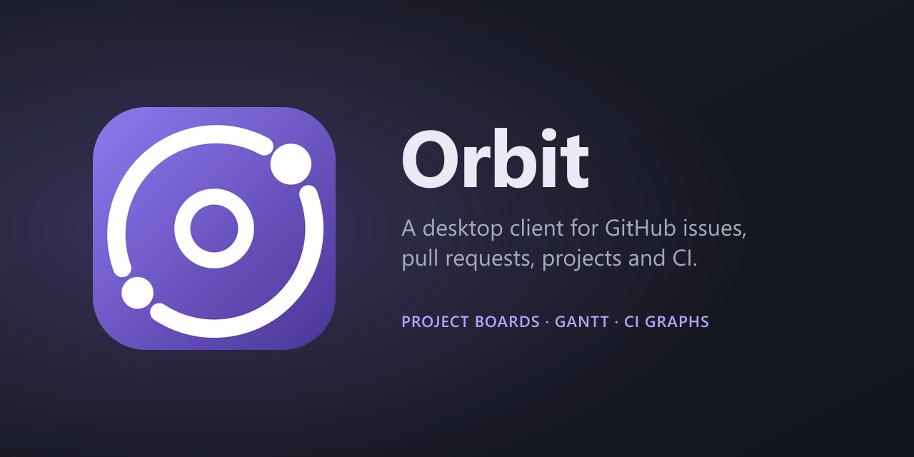

<p align="center">
  
</p>

<h1 align="center">Orbit</h1>

<p align="center">A desktop client for GitHub issues, pull requests, projects, and CI.</p>

<p align="center">
  <a href="https://github.com/chetjones003/orbit/releases"><strong>Download</strong></a> ·
  <a href="https://github.com/chetjones003/orbit/issues">Issues</a> ·
  <a href="#development">Development</a> ·
  <a href="./LICENSE">License</a>
</p>

<p align="center">
  
</p>

Orbit puts your GitHub work in one fast window. Issues and pull requests from every repo you track sit in one list. Open an item full screen, or keep it in a side panel while you work through the next one. Project boards, Gantt charts and CI workflow graphs are built in.

Orbit is built for your own repos. It signs in with GitHub, reads what you can already see, and writes only the changes you make.

## What you get

- **Every item in one list.** Issues and pull requests from all your tracked repositories, grouped by repo, with a state filter and refresh.
- **Side panel that stays out of the way.** One item at a time, floating over the workspace. Drag its edge to resize. A second pick replaces it. Double-click any item for full screen.
- **Projects.** Board, table, Gantt and calendar views over your GitHub Projects, with drag-and-drop on boards.
- **CI at a glance.** Workflow runs as a graph: which job failed, what ran in parallel, and how long each step took.
- **Pull requests you can finish.** Reviews, diffs, merge options and auto-merge without leaving Orbit.
- **Themes.** Light, dark or follow Windows. Five built-in palettes, your own themes, and themes from [Open VSX](https://open-vsx.org). Orbit reads only colours from a theme's package and never runs it.
- **Updates you control.** Orbit asks before it downloads a new version, and shows the release notes first.
- **Open.** GPL-3.0 licensed. Fork it, change it, ship your version.

## Install

### Download

Grab the installer for your system from the [latest release](https://github.com/chetjones003/orbit/releases/latest):

- **Windows:** the NSIS installer (x64)
- **macOS:** the DMG for Apple silicon (arm64) or Intel (x64)
- **Linux:** the AppImage or the `.deb` (x64)

Sign in with your GitHub account when Orbit opens. Orbit asks only for the access it needs to read and update your repos.

## First launch of unsigned builds

Orbit v1 is not code-signed or notarized, so each OS asks for confirmation the first time.

- **Windows:** SmartScreen shows "Windows protected your PC". Click **More info**, then **Run anyway**.
- **macOS:** Gatekeeper blocks a double-click. Right-click `Orbit.app`, choose **Open**, then **Open**
  again. If macOS still refuses, run `xattr -dr com.apple.quarantine /Applications/Orbit.app` once.
- **Linux (AppImage):** `chmod +x Orbit-*.AppImage`, then run it.
- **Linux (deb):** `sudo apt install ./Orbit-*-linux-x64.deb`.

## Development

Requirements: Node.js 24.11.0 (see `.nvmrc`; `engine-strict` refuses other versions) and npm 11.

```sh
nvm use            # or install Node 24.11.0 yourself
npm ci             # installs exactly what package-lock.json pins
npm run dev        # starts the app with hot reload
```

Dependencies are pinned to exact versions. The stack is Electron, electron-vite, React 19, TypeScript and Tailwind CSS with daisyUI.

| Script                           | What it does                                                               |
| -------------------------------- | -------------------------------------------------------------------------- |
| `npm run dev`                    | Run the app with the electron-vite dev server                              |
| `npm run build`                  | Build main, preload and renderer into `out/`                               |
| `npm run typecheck`              | Strict TypeScript for main, preload, shared and renderer                   |
| `npm run lint`                   | ESLint (flat config, typescript-eslint)                                    |
| `npm run format:check`           | Prettier check                                                             |
| `npm run test:unit`              | Unit tests (Vitest, jsdom for the renderer)                                |
| `npm run fake-app -- --cdp 9333` | Run the app against the controlled fake GitHub, with DevTools on port 9333 |
| `npm run icons`                  | Regenerate `build/icon.png` from `build/icon.svg`                          |

Routine tests do not use real GitHub credentials. The fake GitHub server in `tests/fakes/` is the harness for the GitHub-facing code.

## CI

`.github/workflows/ci.yml` runs on every pull request:

1. **Verify** on Ubuntu: format, lint, typecheck, unit tests, build, and integration tests under xvfb.
2. **Package and smoke** on Windows x64, macOS arm64, macOS x64 (smoke-tested under Rosetta), and Linux x64.
   Each packaged artifact is launched signed out with an isolated profile. The app must load its window
   and bundled assets, then exit with code 0.

Installers are uploaded as `orbit-pr<N>-<shortsha>-<os>-<arch>` with 7-day retention. Downloads
from a PR check are for testing only.

## Releases and updates

`.github/workflows/release.yml` publishes a GitHub Release when a `vX.Y.Z` tag is pushed. It only
publishes when:

1. the tag matches `version` in `package.json`, and
2. the tagged commit is on `main`.

It then reruns every `ci.yml` check on all platforms and packaged smoke tests. A single publish job
creates the release with the installers and `latest*.yml` metadata. The two macOS architectures'
metadata is merged by `scripts/merge-update-metadata.mjs`. Releases are never prereleases.

Installed copies check for updates at startup, every four hours, and from **Check for updates** (topbar
or tray). Updates are never offered for prereleases or older versions.

- **Windows, AppImage:** downloaded in the background. Orbit restarts only after you confirm. If you
  have unsent comments or edits, you are warned first.
- **Linux .deb:** downloaded and checked against its sha512, then installed with `pkexec`, which asks for
  administrator credentials.
- **macOS:** the DMG for your CPU architecture is downloaded, checked against its sha512, and opened.
  Drag Orbit into Applications to finish.

## Contributing

Open an issue before a large change so we can agree on the approach. Small, focused fixes are the easiest to review. Run `npm run typecheck`, `npm run lint`, `npm run format:check` and `npm run test:unit` before you open a pull request.

## License

Orbit is free software under the [GNU General Public License v3.0](./LICENSE). You may use, study, change and share it. Anything you distribute must also be GPL-3.0, with its source.
